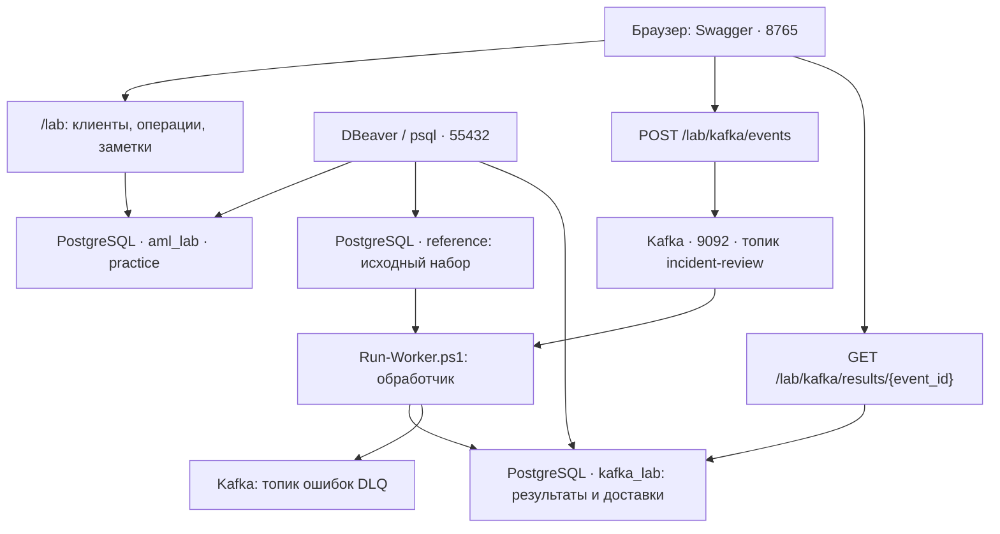

# Сквозная практика: SQL, API и Kafka

Основная установка и полный рабочий цикл собраны в [единой инструкции](service-and-lab.md). Команды этого справочника выполняются из корня вашей копии. Упоминания сохранённых прогонов относятся к указанной дате; их локальные архивы не входят в обычный клон.

Актуально на 05.10.2026. Этот маршрут объединяет учебные компоненты проекта `.`. Он рассчитан на работу из терминалов VS Code и браузера Swagger после уже выполненной установки.

**Архитектура позволяет тренировать полный учебный цикл: запрос API → Kafka → обработчик → PostgreSQL → проверка через API и SQL.** В упражнениях ниже результатом `Run-Worker.ps1` служит сводка операций синтетического клиента. Для цепочки с полноценным AML-анализом и общей историей пошагового интерфейса используйте [Kafka → AML → проверка отчёта](kafka-aml-quickstart.md): новые `/lab/kafka/analyses`, `Run-AmlWorker.ps1` и `Start-IntegratedUI.ps1`.

Выберите маршрут перед запуском:

| Что хотите отработать | Запрос и обработчик | Где завершить проверку |
|---|---|---|
| SQL, публикацию, дубли и DLQ без подготовки модели | `/lab/kafka/events` → `Run-Worker.ps1`; инструкции ниже | `kafka_lab.processed_events`, GET `/lab/kafka/results/{event_id}` |
| Анализ из Kafka и работу оператора с отчётом | `/lab/kafka/analyses` → `Run-AmlWorker.ps1`; [инструкция AML](kafka-aml-quickstart.md) | `kafka_lab.analysis_requests`, GET `/v1/jobs/{job_id}`, интегрированный UI |

Потоки используют общий брокер, но разные топики и группы. Команды `Broker.ps1` без `-Flow` относятся к сводке; для AML добавляйте `-Flow AML`. Запускать оба обработчика для одного упражнения не требуется. Остановка общего брокера влияет на оба потока.

## 1. Как связаны компоненты



Схема читается так: Swagger отправляет обычный HTTP-запрос; API непосредственно публикует событие в Kafka. Отдельно запущенный обработчик читает сообщение, находит инцидент и операции клиента в `reference`, сохраняет результат в `kafka_lab`, затем подтверждает прогресс чтения Kafka. SQL и GET API позволяют независимо проверить сохранённое.

| Компонент | Где находится | Для чего нужен |
|---|---|---|
| Swagger / HTTP API | `http://127.0.0.1:8765/docs` | Отправка запросов, чтение ответов и кодов ошибок |
| PostgreSQL | `127.0.0.1:55432`, база `aml_lab` | SQL, связи таблиц, транзакции, результаты обработки |
| Kafka | `127.0.0.1:9092`, Docker Desktop | Хранение сообщений, разделы, очередь и повторная доставка |
| Обработчик | Отдельный терминал с `Run-Worker.ps1` | Чтение Kafka и запись результата в PostgreSQL |
| Интерфейс AML | `http://127.0.0.1:8501` | Пошаговая проверка отчёта; для этого занятия запуск не требуется |

Обрабатываемый топик — `aml.lab.incident-review.v1`, топик ошибок — `aml.lab.incident-review.dlq.v1`. В каждом три раздела. Группа обработчика — `aml-lab-review-v1`.

### Какие данные общие, а какие отдельные

| Область | Что можно делать | Что влияет на результат |
|---|---|---|
| PostgreSQL `practice` | Учебный SQL-пользователь может менять данные; API читает их и позволяет создавать/изменять/удалять заметки | Изменения видны через `/lab`; изменение SQL само по себе не публикует событие Kafka |
| PostgreSQL `reference` | Читать исходный набор, сравнивать с `practice` | Именно отсюда обработчик сводки берёт инцидент и операции |
| PostgreSQL `kafka_lab` | Учебный SQL-пользователь читает результаты, очереди и доставки | Сводка: `processed_events` / `deliveries`; AML: `analysis_requests` / `analysis_deliveries`. Прямые UPDATE/DELETE учебному пользователю не разрешены |
| Автономный пошаговый AML-интерфейс | Анализ и решения по отчёту без запуска API | Использует зафиксированные файловые источники и `var/workflow/workflow.sqlite3` |
| API `/v1` в том же Swagger | AML-задания, решения и доставка | Использует `var/workflow/api-workflow.sqlite3`; автономная история сюда не переносится |
| Интегрированный UI через `Start-IntegratedUI.ps1` | Проверка AML-заданий из API и нового Kafka-потока | Разделяет `var/workflow/api-workflow.sqlite3` с API; подготовкой и анализом управляет контроллер API |

Таким образом, заметка в `practice.case_notes` не является решением по AML-отчёту. Старый `POST /lab/kafka/events` создаёт только сводку; новый `POST /lab/kafka/analyses` через отдельный AML-обработчик создаёт задание `/v1`, доступное в интегрированном UI. SQL-изменения `practice` не меняют файловые источники AML. Автоматической отправки SQL-изменений в Kafka (CDC) и таблицы исходящих событий (outbox) нет.

## 2. Подготовить три терминала и Swagger

Откройте в VS Code папку проекта. Для Kafka-скриптов нужен **PowerShell 7**. Если терминал использует Windows PowerShell 5.1, в каждом нужном терминале сначала выполните:

```powershell
pwsh -NoLogo
```

Откройте Docker Desktop и дождитесь готовности Linux engine. Повторная установка не нужна. В **терминале A**:

```powershell
# Терминал открыт в корне вашей копии проекта.
.\scripts\lab\Start-Lab.ps1
.\scripts\kafka\Initialize-KafkaLab.ps1
.\scripts\kafka\Broker.ps1 -Action Start
```

Инициализация Kafka-схемы повторяемая: существующие события сохраняются. `Start-Lab.ps1` запускает PostgreSQL и HTTP API в фоне; команда запуска брокера поднимает контейнер. Эти команды ещё не запускают обработчик.

В **терминале B** запустите обработчик и оставьте его работать:

```powershell
# Терминал открыт в корне вашей копии проекта.
.\scripts\kafka\Run-Worker.ps1
```

Для SQL откройте **DBeaver → AML — просмотр → SQL Editor** по [инструкции DBeaver](dbeaver-quickstart.md). Для упражнений с изменениями выбирайте **AML — практика**. Запуск SQL/API через ярлык заменяет `Start-Lab.ps1`, но брокер и обработчик всё ещё запускаются отдельно.

Резервный вариант — в **терминале C** открыть psql:

```powershell
# Терминал открыт в корне вашей копии проекта.
.\scripts\lab\Open-Sql.ps1
```

После приглашения `aml_lab=>` вводятся SQL-команды с `;`. Для выхода в PowerShell — `\q`; для отключения постраничного вывода — `\pset pager off`. В SQL используйте имена со схемой, например `reference.incidents`: имя `incidents` без схемы по умолчанию указывает на `practice`.

В браузере откройте [Swagger](http://127.0.0.1:8765/docs). В терминале A скопируйте ключ:

```powershell
$labAccess = Get-Content .\var\postgres\lab-connection.json -Raw | ConvertFrom-Json
$labAccess.api_token | Set-Clipboard
```

В Swagger: **Authorize → вставить значение без `Bearer` → Authorize → Close**. Swagger передаёт ключ заголовком `X-Lab-Key`. Ключ хранится локально; не добавляйте его в учебный отчёт или Git.

Проверьте через **Try it out → Execute**:

| Запрос | Ожидаемый результат |
|---|---|
| `GET /health` | `200`, `status: ok`: работает HTTP-сервер |
| `GET /lab/status` | `200`, `status: ready`: доступна PostgreSQL |
| `GET /lab/kafka/status` | В теле `broker.status: ready` и `database.status: ready` |

У `/lab/kafka/status` код `200` сам по себе не означает готовность: смотрите оба вложенных статуса. Этот запрос не проверяет процесс обработчика. Его работу подтверждают терминал B, результаты и отставание группы.

## 3. Разминка: один объект через SQL и API

В SQL-редакторе DBeaver (или psql):

```sql
SELECT incident_id, case_id, client_id, alert_type
FROM reference.incidents
WHERE incident_id = 'INC-000123';

SELECT incident_id, case_id, client_id, alert_type
FROM practice.incidents
WHERE incident_id = 'INC-000123';
```

Первая строка нужна для Kafka. Вторая — для обычных `/lab`-запросов; после прежних упражнений она может отличаться. Через Swagger выполните `GET /lab/incidents`; затем `GET /lab/transactions` с `incident_id=INC-000123`, `limit=100`. Сверьте операции в ответе с SQL:

```sql
SELECT t.tx_id, t.amount, t.currency, t.status, t.timestamp
FROM practice.transactions AS t
JOIN practice.incidents AS i ON i.client_id = t.client_id
WHERE i.incident_id = 'INC-000123'
ORDER BY t.timestamp, t.tx_id;
```

API возвращает страницы: параметры `limit` и `offset` относятся только к выдаче, а не ко всем данным. Фильтр `incident_id` выбирает операции клиента инцидента; временной интервал задаётся отдельными параметрами.

Создайте через **POST /lab/notes**:

```json
{"incident_id":"INC-000123","body":"Практика интеграции: сверены SQL и API"}
```

Ожидается **201**. Сохраните `id` и `revision`. Повторное нажатие Execute создаст новую заметку: у этого POST нет устранения дублей по `event_id` или заголовку `Idempotency-Key`. В SQL найдите заметку, подставив свой UUID:

```sql
-- Замените пример UUID на id созданной заметки.
SELECT id, incident_id, body, revision
FROM practice.case_notes
WHERE id = '00000000-0000-4000-8000-000000000001'::uuid;
```

Измените заметку через `PATCH /lab/notes/{note_id}` с телом `{"body":"Сверка выполнена; изучаю Kafka","expected_revision":1}`. При первой правке ожидается **200**, ревизия `2`; повтор с прежней ревизией `1` даст **409**. Повторите SELECT и увидите изменение. Никакого сообщения Kafka при этом не создаётся.

Если учебный инцидент был удалён из `practice`, упражнение с заметкой не выполнится. Выберите существующий учебный инцидент или восстановите набор по [инструкции SQL/API](sql-api-quickstart.md). Сброс удаляет изменения в `practice`, поэтому для обычного занятия его выполнять не нужно.

## 4. Отправить событие и проследить весь путь

### Сохранить тело запроса

В терминале A создайте **новое** событие и сохраните JSON для повторов:

```powershell
$trainingEvent = [ordered]@{
    event_id = [guid]::NewGuid().ToString()
    occurred_at = [DateTime]::UtcNow.ToString('o')
    incident_id = 'INC-000123'
    schema_version = 1
    event_type = 'incident.review.requested.v1'
    synthetic = $true
}
$trainingDirectory = Join-Path (Get-Location) 'var\practice-sessions'
New-Item -ItemType Directory -Path $trainingDirectory -Force | Out-Null
$trainingFile = Join-Path $trainingDirectory ('event-' + $trainingEvent.event_id + '.json')
$trainingEvent | ConvertTo-Json | Set-Content -LiteralPath $trainingFile -Encoding utf8
Get-Content -LiteralPath $trainingFile -Raw | Set-Clipboard
$trainingEvent.event_id
```

В Swagger откройте **POST /lab/kafka/events → Try it out**, вставьте сохранённое тело и нажмите **Execute**. Скопируйте ответ рядом с JSON в свои заметки: нужны `event_id`, `topic`, `partition`, `offset` и HTTP-код.

Для практики HTTP без Swagger тот же запрос можно отправить из терминала A. Это будет **повтор публикации**, если Swagger уже отправил его:

```powershell
$labHeaders = @{ 'X-Lab-Key' = $labAccess.api_token }
Invoke-RestMethod -Method Post -Uri 'http://127.0.0.1:8765/lab/kafka/events' -Headers $labHeaders -ContentType 'application/json' -Body (Get-Content -LiteralPath $trainingFile -Raw)
```

Если открыли новый терминал, заново прочитайте `$labAccess` и укажите путь к сохранённому `$trainingFile`. Для повтора не генерируйте новое `occurred_at` или UUID.

### Что происходит после Execute

1. API проверяет ключ доступа и структуру события. Некорректное тело отклоняется с `400` до публикации.
2. API напрямую публикует событие. Ключ сообщения — `incident_id`, значение — проверенное тело JSON. Отдельного HTTP-заголовка `Idempotency-Key` у этого маршрута нет: идентичность события задаётся `event_id` и его содержимым.
3. Kafka подтверждает запись. API отвечает **202**, `status: broker_acknowledged`, `processing: check_result_separately` и координатами сообщения. Это ещё не подтверждение обработки.
4. Обработчик из терминала B читает сообщение. Он находит клиента через `reference.incidents` и считает все его операции из `reference.transactions`, включая все статусы, отдельно по валютам. Временного окна AML-политики в этой сводке нет; `occurred_at` не используется как фильтр операций.
5. Одной транзакцией PostgreSQL сохраняются результат в `kafka_lab.processed_events` и позиция доставки в `kafka_lab.deliveries`.
6. После фиксации SQL обработчик подтверждает Kafka следующее смещение — `offset + 1`. В терминале B появляется `processed` либо `duplicate`.
7. Вы читаете сохранённое через GET API и SQL.

### Проверить результат с двух сторон

В Swagger: **GET /lab/kafka/results/{event_id}**, подставьте UUID события. Ожидается **200**, `status: processed`, внутри `result` — `kind: snapshot_bookkeeping`, `client_id`, `transaction_count` и `transaction_totals_by_currency`. Ответ **404 / KAFKA_RESULT_NOT_FOUND** означает, что результата пока нет: проверьте обработчик и DLQ, прежде чем повторять отправку.

В SQL-редакторе DBeaver выполните запросы ниже. Во всех следующих примерах заменяйте `00000000-0000-4000-8000-000000000002` на UUID своего события. Эти же запросы работают в psql:

```sql
-- Во всех фильтрах используйте event_id своего события.

SELECT event_id, incident_id, occurred_at, processed_at,
       topic, partition, offset_value, result_json
FROM kafka_lab.processed_events
WHERE event_id = '00000000-0000-4000-8000-000000000002'::uuid;

SELECT topic, partition, offset_value, duplicate, recorded_at
FROM kafka_lab.deliveries
WHERE event_id = '00000000-0000-4000-8000-000000000002'::uuid
ORDER BY topic, partition, offset_value;
```

Если событие опубликовано один раз, после успешной обработки ожидается одна строка в каждой таблице. Если выполнили также PowerShell-повтор, после обработки обоих сообщений ожидается один результат и две доставки. `offset_value` в SQL соответствует `offset` в API. При повторных публикациях `processed_events` сохраняет координаты первоначального результата; новые координаты ищите в `deliveries`.

## 5. Проверить расчёт самостоятельно через SQL

Сначала свяжите результат с исходным инцидентом и клиентом:

```sql
SELECT e.event_id, i.incident_id, c.client_id, c.kyc_status,
       e.result_json->>'kind' AS result_kind,
       (e.result_json->>'transaction_count')::integer AS saved_count
FROM kafka_lab.processed_events AS e
JOIN reference.incidents AS i ON i.incident_id = e.incident_id
JOIN reference.clients AS c ON c.client_id = i.client_id
WHERE e.event_id = '00000000-0000-4000-8000-000000000002'::uuid;
```

Затем разверните JSON и сопоставьте суммы с исходными строками. Все значения `matches` должны быть `true` для текущего неизменённого набора:

```sql
WITH saved AS (
    SELECT x.currency, x.transaction_count, x.total_amount
    FROM kafka_lab.processed_events AS e
    CROSS JOIN LATERAL jsonb_to_recordset(
        e.result_json->'transaction_totals_by_currency'
    ) AS x(currency text, transaction_count bigint, total_amount numeric)
    WHERE e.event_id = '00000000-0000-4000-8000-000000000002'::uuid
), expected AS (
    SELECT t.currency, count(*) AS transaction_count, sum(t.amount) AS total_amount
    FROM reference.transactions AS t
    JOIN reference.incidents AS i ON i.client_id = t.client_id
    JOIN kafka_lab.processed_events AS e ON e.incident_id = i.incident_id
    WHERE e.event_id = '00000000-0000-4000-8000-000000000002'::uuid
    GROUP BY t.currency
)
SELECT coalesce(s.currency, r.currency) AS currency,
       s.transaction_count AS saved_count, r.transaction_count AS sql_count,
       s.total_amount AS saved_amount, r.total_amount AS sql_amount,
       coalesce(s.transaction_count = r.transaction_count
                AND s.total_amount = r.total_amount, false) AS matches
FROM saved AS s
FULL JOIN expected AS r ON r.currency = s.currency
ORDER BY currency;
```

Перед сравнением убедитесь, что результат события существует: пустая выдача не доказывает совпадение. Не объединяйте RUB и USD в одну сумму. Не добавляйте фильтр `status='completed'` или период, если хотите воспроизвести именно текущий Kafka-расчёт. Изменения в `practice` не должны менять этот результат.

## 6. Упражнения с сообщениями и отказами

| Опыт | Что сделать | Что проверить |
|---|---|---|
| Повтор события | Отправить сохранённое тело ещё раз | Новый Kafka offset; один результат по UUID; дополнительная доставка с `duplicate=true` |
| Очередь | Остановить только обработчик через Ctrl+C; отправить новое событие | `202`, но результата нет; затем запустить обработчик и получить результат |
| Порядок | Последовательно отправить три новых UUID для одного инцидента | Один раздел, возрастающие offsets; `occurred_at` не сортирует очередь |
| Ошибка входа API | Отправить тело без `event_id` или с `synthetic=false` | `400`; в Kafka и DLQ это тело не публикуется |
| Ошибка внутри Kafka | В терминале A выполнить `.\scripts\kafka\Broker.ps1 -Action PublishInvalid` | Обработчик выводит `dead_lettered`, причина `INVALID_EVENT`; запись появляется в DLQ |
| Конфликт UUID | В сохранённом корректном событии изменить время, сохранив UUID, и отправить | API может вернуть `202`; обработчик отправит конфликт в DLQ как `EVENT_CONFLICT`, исходный SQL-результат сохранится |
| Брокер недоступен | Остановить обработчик, затем брокер; отправить новое тело | `503`; после восстановления повторить то же тело с тем же UUID |

Каждый опыт с очередью начинайте после завершения предыдущего. Проверяйте конкретные UUID: в таблицах уже есть результаты прежних занятий.

Команды диагностики вводятся в терминале A:

```powershell
.\scripts\kafka\Broker.ps1 -Action Status
.\scripts\kafka\Broker.ps1 -Action Topics
.\scripts\kafka\Broker.ps1 -Action Lag
.\scripts\kafka\Broker.ps1 -Action ReadDlq
```

`Lag` — отставание группы от конца раздела. До первого запуска обработчика группа может отсутствовать. `Lag=0` не доказывает успешность всех событий: ошибочное сообщение тоже может быть обработано с отправкой в DLQ. Проверяйте результат нужного UUID и причину в DLQ. `ReadDlq` показывает ограниченную выборку, а не весь архив; позиция исходного сообщения находится в `source`.

Сводка по вашему событию:

```sql
SELECT count(*) AS result_count
FROM kafka_lab.processed_events
WHERE event_id = '00000000-0000-4000-8000-000000000002'::uuid;

SELECT count(*) AS processed_positions,
       count(*) FILTER (WHERE duplicate) AS duplicate_positions
FROM kafka_lab.deliveries
WHERE event_id = '00000000-0000-4000-8000-000000000002'::uuid;
```

`deliveries` учитывает уникальные позиции Kafka, а не все попытки чтения. Если процесс упал после SQL COMMIT, но до подтверждения Kafka, одна и та же позиция может читаться снова без второй строки доставки. PostgreSQL и Kafka фиксируют прогресс раздельно: это доставка с возможными повторами и устранением дублей результата, а не общая транзакция «ровно один раз».

Подробный порядок опытов и дополнительные SQL-запросы: [10 упражнений Kafka](../../lab/kafka/exercises.md). Для автоматической проверки уже запущенного стенда в терминале A доступна `.\scripts\kafka\Test-KafkaLab.ps1`: она создаёт новое синтетическое событие, отправляет его дважды и оставляет результат в БД.

## 7. Быстро найти причину проблемы

| Наблюдение | Где проверять и что делать |
|---|---|
| Swagger не открывается | Выполнить `Start-Lab.ps1`; проверить порт 8765 и `var/logs/lab-api.err.log` |
| `401` | Повторить Authorize с локальным ключом; это не ошибка Kafka |
| `400` | Проверить обязательные поля, формат UUID/инцидента и время с часовым поясом; сообщения ещё нет в Kafka |
| POST события вернул `503` | Сохранить тело; проверить поле `publication` и брокер. При `unknown` запись могла состояться; после восстановления повторять исходное тело |
| `202`, затем GET результата `404` | Проверить терминал B, Lag и DLQ; POST подтвердил только Kafka |
| GET результата вернул `503` | Проверить PostgreSQL и Kafka-схему; недоступность чтения не доказывает отсутствие результата |
| В статусе БД `INVALID_STATE` | После запуска PostgreSQL выполнить `Initialize-KafkaLab.ps1`; если ошибка остаётся, сохранить код для разбора |
| Обработчик завершился с `DATABASE_UNAVAILABLE` | Восстановить PostgreSQL через `Start-Lab.ps1`, затем снова запустить `Run-Worker.ps1`; автоматического перезапуска процесса нет |
| В DLQ `UNKNOWN_INCIDENT` | Проверить инцидент в `reference.incidents`; запись только в `practice` для Kafka недостаточна |
| SQL не разрешает менять `kafka_lab` | Использовать `practice` для INSERT/UPDATE/DELETE; `kafka_lab` учебному пользователю доступна для чтения |
| После SQL UPDATE API показывает прежнее | Проверить схему `practice`, выбранную запись и COMMIT: незавершённая транзакция SQL не видна соединению API |

## 8. Завершить занятие и зафиксировать результат

1. В терминале B остановите обработчик через **Ctrl+C**.
2. В DBeaver завершите открытые учебные транзакции осознанно (`COMMIT` сохраняет изменения, `ROLLBACK` отменяет) и отключите соединения. Если использовали psql в терминале C, выйдите через `\q`.
3. В терминале A:

```powershell
.\scripts\kafka\Broker.ps1 -Action Stop
.\scripts\lab\Stop-Lab.ps1
```

Обычная остановка сохраняет данные. Закрытие браузера службы не останавливает. Если параллельно работает AML-поток, сначала завершите или отмените его задания и остановите его обработчик: брокер и API у потоков общие. Kafka хранит сообщения ограниченное время: настроено 7 дней либо около 128 МиБ на раздел; это не резервная копия. Один брокер с одной копией сообщений предназначен для локальной практики. Повторная отправка спустя занятие использует сохранённое тело события; запуск нового опыта — новый UUID.

Краткая запись по каждому опыту:

| Что записать | Ваш результат |
|---|---|
| Название опыта, дата | |
| Путь к JSON / `event_id` / `incident_id` | |
| POST: код, topic, partition, offset | |
| Обработчик: processed / duplicate / dead_lettered / failed | |
| GET результата: код | |
| SQL: число результатов и доставок, совпали ли суммы | |
| Lag и причина DLQ, если были | |
| Что означает наблюдение | |

## Следующий маршрут: практика полного AML-процесса

Для работы начинающего оператора используйте [пошаговый интерфейс и его инструкцию](service-quickstart.md). Для изучения HTTP-контрактов AML доступны `/v1/readiness`, `/v1/jobs`, отчёты, решения и доставка в Swagger; последовательность приведена в [API-упражнениях](../../lab/api/README.md). Контроллер API обслуживает также интегрированный UI; автономный UI запускает собственный контроллер. На первых занятиях со сводкой SQL/Kafka подготовка AML-модели не нужна.

Для передачи настоящего AML-задания через Kafka предусмотрен [отдельный маршрут запуска и упражнений](kafka-aml-quickstart.md). Он использует устойчивую очередь `kafka_lab.analysis_requests`, связывает `event_id` с `job_id` и версией отчёта, а `Start-IntegratedUI.ps1` открывает общую историю API. Решение и экспорт выполняет оператор; прежний маршрут сводки продолжает работать самостоятельно.

У AML-потока другой момент подтверждения: обработчик подтверждает Kafka **после сохранения запроса в PostgreSQL**, затем отдельно передаёт его в API и обновляет результат. Поэтому `Lag=0` и строка `queued` ещё не означают готовый отчёт. Даже без новых сообщений обработчик возвращается к сохранённой очереди. Для завершённой цепочки проверьте `succeeded`, `job_id`, `report_id`, версию отчёта и откройте это же задание в UI; одобрение и экспорт выполняются отдельными действиями.

Инструкция сверена с кодом API, обработчиков, схем БД и PowerShell-скриптов. Учебный цикл сводки ранее проверен 02.10.2026 (локальный материал: `verification/kafka-live-2026-10-02/summary.md`); этот результат не подтверждает новый маршрут Kafka → AML. Обновление инструкции 05.10.2026 само по себе не является запуском стенда.
