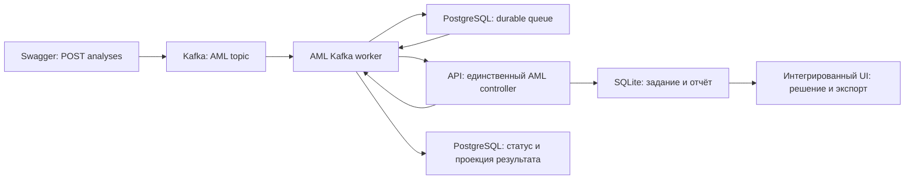

# Kafka → AML-анализ → пошаговая проверка

Основная установка и полный рабочий цикл собраны в [единой инструкции](service-and-lab.md). Команды этого справочника выполняются из корня вашей копии. Упоминания сохранённых прогонов относятся к указанной дате; их локальные архивы не входят в обычный клон.

Интеграция отдельного проекта rebuild, актуально на 05.10.2026. Этот режим связывает AML-задание API с событием Kafka и общей историей в интерфейсе. Используются существующие синтетические источники и учебная политика; решение и экспорт по-прежнему выполняет оператор.

Цель первого занятия: отправить одно событие, найти связанное задание через SQL и API, открыть его отчёт в пошаговом интерфейсе и вручную пройти проверку. Для этого маршрута используйте команды ниже. Сводка операций без AML-процесса остаётся отдельным [упражнением SQL/API/Kafka](integration-practice.md).

## Как проходит запрос



API отвечает `202` после подтверждения Kafka. Kafka-обработчик сначала сохраняет запрос в PostgreSQL и только после этого подтверждает позицию Kafka. Затем он передаёт сохранённый запрос в `/v1/jobs` с постоянным ключом `kafka-aml:<event_id>`. При потерянном ответе повторяется тот же запрос, поэтому второе задание не создаётся. Завершение анализа проверяется отдельно; статус и результат переносятся в PostgreSQL. Обработчик проверяет сохранённую очередь и принятые задания даже без новых сообщений Kafka.

| Объект | Название / назначение |
|---|---|
| Топик AML | `aml.lab.analysis-requested.v1` |
| AML DLQ | `aml.lab.analysis-requested.dlq.v1` |
| Группа AML-обработчика | `aml-lab-analysis-v1` |
| Очередь PostgreSQL | `kafka_lab.analysis_requests` — события, привязка к заданию и результат |
| Доставки PostgreSQL | `kafka_lab.analysis_deliveries` — обработанные позиции Kafka |
| Общая история API и интегрированного UI | `var/workflow/api-workflow.sqlite3` |
| Автономная история прежнего UI | `var/workflow/workflow.sqlite3`, сохраняется отдельно |

Старый `POST /lab/kafka/events` и `Run-Worker.ps1` продолжают учебный расчёт сводки; для AML используйте новые маршруты и `Run-AmlWorker.ps1`. Брокер общий, топики и группы разные. Источники AML остаются зафиксированными файлами: SQL-изменения `practice` не подменяют исходные данные отчёта.

## 1. Запустить службы

Откройте Docker Desktop и дождитесь Linux engine. Откройте проект `.` в VS Code и три терминала **PowerShell 7**. При необходимости перейти из Windows PowerShell:

```powershell
pwsh -NoLogo
```

В терминале A:

```powershell
# Терминал открыт в корне вашей копии проекта.
.\scripts\lab\Start-Lab.ps1
.\scripts\kafka\Initialize-AmlIntegration.ps1
.\scripts\kafka\Broker.ps1 -Action Start -Flow AML
```

Инициализация добавляет таблицы AML-очереди и сохраняет существующие учебные данные. Если API работал до обновления кода, сначала завершите текущие задания/обработчики и перезапустите его через `Stop-Lab.ps1`, затем `Start-Lab.ps1`. Повторный Start-Lab не перезагружает уже работающий API.

Для первого занятия достаточно одного `Run-AmlWorker.ps1`; `Run-Worker.ps1` нужен только для отдельного потока сводки. Оба используют один брокер, но не обрабатывают топики друг друга.

В терминале B запустите **интегрированный**, а не автономный интерфейс:

```powershell
# Терминал открыт в корне вашей копии проекта.
.\scripts\rebuild\Start-IntegratedUI.ps1
```

Откройте [интерфейс](http://127.0.0.1:8501). Проверьте надпись **«Интегрированный режим: общая история с API и Kafka»**. На первом этапе нажмите **«Подготовить поиск»**, дождитесь готовности. Запрос уходит в API; второй AML-контроллер внутри UI не запускается. Автономный UI на том же порту нужно предварительно остановить в его терминале через Ctrl+C.

В терминале C:

```powershell
# Терминал открыт в корне вашей копии проекта.
.\scripts\kafka\Run-AmlWorker.ps1
```

При неподготовленном или занятом поиске события остаются в PostgreSQL и ждут доступности API. Обработчик сам не запускает подготовку модели. После восстановления готовности очередь продолжает обрабатываться без повторной публикации события.

Первые контрольные запросы в Swagger: `GET /health` — HTTP `200`, `GET /lab/status` — `status: ready`, `GET /lab/kafka/analyses/status` — оба вложенных статуса `broker.status` и `database.status` равны `ready`, `GET /v1/readiness` — `ready: true` после подготовки. Статус Kafka не проверяет запущенный процесс обработчика: его готовность дополнительно видна в терминале C. Для защищённых запросов сначала выполните авторизацию из следующего раздела.

## 2. Отправить AML-событие из Swagger

Откройте [Swagger](http://127.0.0.1:8765/docs). В терминале A:

```powershell
$labAccess = Get-Content .\var\postgres\lab-connection.json -Raw | ConvertFrom-Json
$labAccess.api_token | Set-Clipboard
```

В Swagger нажмите **Authorize**, вставьте значение без `Bearer`, затем **Authorize → Close**.

Создайте тело события в терминале A. Окно анализа берётся из действующей учебной политики и сохраняется вместе с событием:

```powershell
$demoPolicy = Get-Content .\config\demo-policy.json -Raw | ConvertFrom-Json
$amlEvent = [ordered]@{
    event_id = [guid]::NewGuid().ToString()
    occurred_at = [DateTime]::UtcNow.ToString('o')
    incident_id = 'INC-000123'
    schema_version = 1
    event_type = 'aml.analysis.requested.v1'
    synthetic = $true
    engine = 'template'
    window = $demoPolicy.window
}
$amlStudyDirectory = Join-Path (Get-Location) 'var\practice-sessions'
New-Item -ItemType Directory -Path $amlStudyDirectory -Force | Out-Null
$amlEventFile = Join-Path $amlStudyDirectory ('aml-event-' + $amlEvent.event_id + '.json')
$amlEvent | ConvertTo-Json -Depth 5 | Set-Content -LiteralPath $amlEventFile -Encoding utf8
Get-Content -LiteralPath $amlEventFile -Raw | Set-Clipboard
$amlEvent.event_id
```

В группе **Kafka AML analysis** откройте **POST /lab/kafka/analyses → Try it out**, вставьте JSON и нажмите Execute. Сохраните UUID и ответ `202` с topic/partition/offset. `template` запускает действующий AML-процесс с поиском, проверками источников и формированием отчёта без LLM. Дополнительный `local-model` требует уже работающего Ollama; для первого опыта оставьте `template`.

`occurred_at` — время события, а `window` — исторический период анализа из `config/demo-policy.json`. Не заменяйте окно текущей датой: API принимает действующее учебное окно. Для повтора используйте сохранённый файл целиком; не генерируйте новый UUID, время или окно. Новый UUID означает новое самостоятельное задание.

Тот же запрос можно выполнить из PowerShell, чтобы отработать API без Swagger. Если Swagger уже отправил тело, команда ниже публикует его повторно:

```powershell
$amlHeaders = @{ 'X-Lab-Key' = $labAccess.api_token }
Invoke-RestMethod -Method Post -Uri 'http://127.0.0.1:8765/lab/kafka/analyses' -Headers $amlHeaders -ContentType 'application/json' -Body (Get-Content -LiteralPath $amlEventFile -Raw)
```

В новом терминале повторно прочитайте `$labAccess` и укажите путь к ранее сохранённому `$amlEventFile`. Дополнительный заголовок `Idempotency-Key` этому маршруту не нужен: идентичность задаётся `event_id` и телом; ключ для `/v1/jobs` формирует обработчик.

Читайте **GET /lab/kafka/analyses/{event_id}**:

| Состояние | Что означает |
|---|---|
| `404 / AML_REQUEST_NOT_FOUND` | Событие пока не сохранено в PostgreSQL; проверьте AML worker, lag и DLQ |
| `queued` | Событие сохранено и ожидает приёма API; `job_id` ещё может отсутствовать |
| `submitted` | API принял задание; `job_id` позволяет открыть `/v1/jobs/{job_id}`; `job_json.status` показывает состояние последнего опроса |
| `succeeded` | Отчёт готов к проверке; это ещё не одобрение оператора |
| `refused`, `failed`, `timed_out`, `cancelled` | Задание завершилось соответствующим исходом; смотрите `job_json` и историю UI |
| `rejected` | Сохранённый запрос не принят API из-за постоянной ошибки; смотрите `last_error_code` |

Статусы в PostgreSQL обновляет работающий AML Kafka worker. После его остановки API может завершить уже принятое задание, а PostgreSQL останется на прежнем статусе до следующего запуска обработчика. Авторитетный текущий результат доступен через `/v1/jobs/{job_id}` и общую историю UI.

## 3. Проверить отчёт и принять решение в UI

Вернитесь в браузер на порт 8501, нажмите **«Обновить состояние»**. В боковой панели раскройте **«Запросы AML из Kafka»**, найдите свой `event_id` и нажмите **«Открыть задание из Kafka»**, когда появится `job_id`. Там показываются последние 20 запросов. Задание также доступно в обычной истории: выберите его по инциденту и `job_id`, нажмите **«Открыть сохранённое задание»**. Повторно создавать задание на этапе «Инцидент» для этого не нужно.

Продолжайте обычные этапы: **Проверка отчёта → Решение → Сохранение и экспорт**. Сверьте источники, выберите действие и заполните обоснование. Kafka не одобряет отчёт, не назначает реального получателя и не выполняет экспорт автоматически. Правила блокировки решения после принятого экспорта сохраняются.

Закрытие интегрированного UI не останавливает API-контроллер и не отменяет его задания. Если API недоступен, сохранённую историю можно просматривать, но подготовка и запуск новых заданий требуют восстановления API. Для возврата к старой автономной истории запускайте прежнюю команду из [инструкции сервиса](service-quickstart.md), предварительно остановив интерфейс на 8501.

## 4. SQL: связать событие, задание и отчёт

Откройте **DBeaver → AML — просмотр → SQL Editor** по [инструкции DBeaver](dbeaver-quickstart.md). Во всех SQL-фильтрах ниже замените `00000000-0000-4000-8000-000000000002` на UUID своего события. Резервный клиент — `.\scripts\lab\Open-Sql.ps1` из терминала A; SQL одинаков для обоих клиентов.

```sql
-- Подставьте UUID своего события во все WHERE ниже.

SELECT event_id, incident_id, engine, status, job_id,
       report_id, report_version, content_sha256,
       last_error_code, created_at, updated_at
FROM kafka_lab.analysis_requests
WHERE event_id = '00000000-0000-4000-8000-000000000002'::uuid;

SELECT topic, partition, offset_value, duplicate, recorded_at
FROM kafka_lab.analysis_deliveries
WHERE event_id = '00000000-0000-4000-8000-000000000002'::uuid
ORDER BY topic, partition, offset_value;

SELECT job_json->>'status' AS job_status,
       job_json->'result' AS result
FROM kafka_lab.analysis_requests
WHERE event_id = '00000000-0000-4000-8000-000000000002'::uuid;
```

Результат в PostgreSQL — проекция задания, предназначенная для учебных запросов. Решения оператора и квитанции экспорта хранятся в SQLite; их изменение не переписывает `job_json`. Учебному SQL-пользователю доступно чтение интеграционных таблиц, а упражнения с UPDATE/DELETE выполняются в `practice`.

Для тренировки JOIN и агрегирования выполните:

```sql
SELECT r.event_id, r.status, r.job_id, r.report_id, r.report_version,
       count(d.offset_value) AS recorded_positions,
       count(d.offset_value) FILTER (WHERE d.duplicate) AS duplicate_positions
FROM kafka_lab.analysis_requests AS r
LEFT JOIN kafka_lab.analysis_deliveries AS d USING (event_id)
WHERE r.event_id = '00000000-0000-4000-8000-000000000002'::uuid
GROUP BY r.event_id, r.status, r.job_id, r.report_id, r.report_version;

SELECT event_json->'window' AS frozen_window,
       job_json->'result'->>'snapshot_id' AS snapshot_id,
       jsonb_array_length(job_json->'result'->'found_facts') AS facts_count
FROM kafka_lab.analysis_requests
WHERE event_id = '00000000-0000-4000-8000-000000000002'::uuid AND status = 'succeeded';
```

Сверьте `job_id`, `report_id`, `report_version` и `found_facts` с `GET /v1/jobs/{job_id}` и открытым отчётом в UI. После одной публикации ожидается одна позиция доставки; после публикации того же тела ещё раз — дополнительная позиция, но тот же `job_id`. Повторное чтение одной и той же позиции Kafka после сбоя не добавляет вторую строку `analysis_deliveries`. Пустая выдача запроса с `status='succeeded'` означает, что готовый отчёт пока не найден, а не успешное сравнение.

## 5. Проверить повторы и восстановление

1. **Повтор тела:** отправьте тот же JSON ещё раз. После обработки ожидаются тот же `event_id`, тот же `job_id`, один отчёт по заданию и дополнительная позиция в `analysis_deliveries`. Для нового самостоятельного анализа создайте новый UUID.
2. **Очередь без модели:** оставьте поиск неподготовленным и отправьте событие. Оно должно попасть в `queued`; после подготовки API — перейти к заданию. `Lag=0` здесь может означать только перенос события в устойчивую очередь PostgreSQL.
3. **Остановка worker:** нажмите Ctrl+C в терминале C. Уже принятый API анализ продолжается. После запуска worker он обновит проекцию результата даже без новых событий Kafka.
4. **Перезапуск API:** после аварийной потери API принятое задание может быть восстановлено как ошибка. Повтор события возвращает то же задание с этим исходом, а не скрыто создаёт новый анализ. Новая попытка — отдельное событие с новым UUID.
5. **Изменённое тело с прежним UUID:** после первого сохранения события повтор с другим содержимым считается конфликтом и направляется в AML DLQ. Исходная запись и задание сохраняются.
6. **Некорректное сообщение:** выполните `.\scripts\kafka\Broker.ps1 -Action PublishInvalid -Flow AML`. После обработки ожидается `dead_lettered` с `INVALID_EVENT` в AML DLQ, без нового AML-задания. Некорректное тело, отправленное через обычный POST Swagger, отклоняется API до Kafka и в DLQ не попадает.

В PowerShell для этого потока используйте `-Flow AML`:

```powershell
.\scripts\kafka\Broker.ps1 -Action Lag -Flow AML
.\scripts\kafka\Broker.ps1 -Action ReadDlq -Flow AML
```

Проверка доступности: `GET /lab/kafka/analyses/status` проверяет брокер и очередь, `/v1/readiness` — AML-контроллер. HTTP `200` у статуса Kafka не заменяет проверку вложенных полей. `503` при публикации может означать потерянное подтверждение: повторяйте всё исходное тело, включая window/occurred_at/engine.

Сбой PostgreSQL или фиксации позиции прекращает worker; восстановите зависимость и повторите `Run-AmlWorker.ps1`. Ошибки доступа к API также требуют исправления причины и перезапуска. Не меняйте сохранённое тело события или его ключ, чтобы обойти конфликт. Не удаляйте БД или Docker volume для обычного повтора.

| Наблюдение | Следующее действие |
|---|---|
| В Swagger нет группы Kafka AML analysis | Завершить текущие задания и перезапустить API после обновления кода; обновить страницу Swagger |
| POST вернул `400` | Проверить формат события, `synthetic: true`, тип события и окно из действующей политики; сообщение не опубликовано |
| POST вернул `202`, GET — `404` | Проверить, что работает именно `Run-AmlWorker.ps1`; посмотреть `Lag -Flow AML` и `ReadDlq -Flow AML` |
| Долго сохраняется `queued` | Проверить `last_error_code`, `/v1/readiness` и терминал C; подготовить поиск в интегрированном UI или дождаться свободного контроллера |
| В API отчёт готов, в PostgreSQL ещё `submitted` | Запустить AML-обработчик: он обновляет проекцию после завершения анализа |
| Задание видно в Swagger, но нет в UI | Проверить интегрированный режим и `job_id`; автономная история отдельная |
| `rejected` | Сохранить `last_error_code` для разбора. Исправление тела с прежним UUID создаст конфликт; исправленный самостоятельный запрос должен иметь новый UUID |
| БД в статусе `INVALID_STATE` | После запуска PostgreSQL выполнить `Initialize-AmlIntegration.ps1`; если ошибка сохраняется, остановить упражнение и сохранить код для разбора |

Для заметок по опыту сохраните путь к JSON, UUID события, Kafka topic/partition/offset, `job_id`, конечный статус, `report_id`/версию и результат SQL-сверки. Ключ `X-Lab-Key` в заметки не включайте.

### Автоматически повторить сквозную проверку

Когда API, брокер, таблицы интеграции и AML worker уже запущены, в отдельном терминале PowerShell из корня проекта выполните:

```powershell
& .\.venv\Scripts\python.exe -I -B scripts/kafka/qualify_aml_cycle.py --prepare-search
```

Команда явно разрешает подготовить поиск, если он ещё не готов. Каждый запуск публикует **одно новое синтетическое событие и его точный повтор**, проверяет одинаковый `job_id`, результат в PostgreSQL/API/общей SQLite-истории и оставляет черновик для ручной проверки. Автоматического одобрения или экспорта нет. Службы должны быть запущены заранее; сценарий их не запускает, не останавливает и не очищает данные. Результат и тело события сохраняются в новом подкаталоге `var/checks/kafka-aml-cycle`; ожидаемый итог — `status: PASS`.

Такой прогон выполнен 05.10.2026 с реальным поиском и движком `template`: результаты и границы проверки (локальный материал: `verification/kafka-aml-2026-10-04/summary.md`).

## 6. Остановить стенд

Дождитесь завершения заданий или явно отмените нужное задание в UI. Затем:

1. Ctrl+C в терминале C останавливает AML Kafka worker.
2. Ctrl+C в терминале B останавливает UI.
3. В DBeaver завершите транзакции через Commit/Rollback и отключите соединения; если использовали psql в терминале A, выйдите командой `\q`.
4. В терминале A выполните:

```powershell
.\scripts\kafka\Broker.ps1 -Action Stop -Flow AML
.\scripts\lab\Stop-Lab.ps1
```

Остановка брокера затрагивает оба Kafka-потока. Остановка API прекращает его контроллер и может отменить незавершённые AML-задания. Очередь PostgreSQL, завершённые отчёты и обе истории сохраняются. Подтверждённый перенос в PostgreSQL позволяет продолжить очередь даже после удаления исходного сообщения Kafka по сроку хранения; потерю самой БД эта схема не компенсирует.

Остановка обработчика не отменяет сохранённые запросы `queued`: при следующем запуске они продолжат ждать готового API. Кнопка отмены в UI относится к уже принятому заданию с `job_id`, а не к очереди ещё не принятых событий.

Инструкция сверена с реализацией 05.10.2026. Сквозной запуск `template` и открытие сохранённого отчёта в браузере проверены; дополнительные границы проверки указаны в итоговом протоколе выше.
